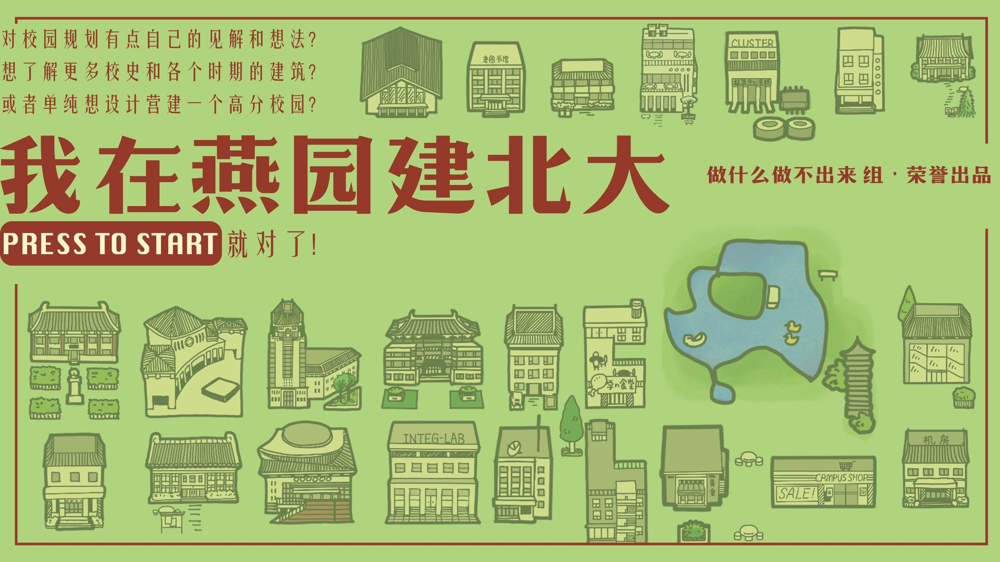

# 我在燕园建北大 · BuildPKU

[简体中文](#简体中文) | [English](#english)



[观看演示视频 / Watch Gameplay](assets/audio/preview.mp4)

## 简体中文

**从一座校园出发，建设你心中的北大。**

《我在燕园建北大》（BuildPKU）是一款以北京大学校园为背景的 2D 校园建设与策略经营游戏，是 **2026 年网易雷火 × 北京大学 Game Jam** 参赛作品，获得了**优秀作品奖**。

游戏使用 **Godot + C#** 开发，将校园建设、资源经营与卡牌选择结合起来。你需要在有限的资金和空间中安排建筑，平衡科研、教学与环境，让校园在一年年的发展中积累声誉，完成不同阶段的发展目标。

### 游戏玩法

游戏从 **1952 年**开始，以年度为单位推进，最终目标是完成 **2026 年**的声誉里程碑。

- **规划校园布局**：建造宿舍、教学楼、实验室、食堂等设施，在校园地图上安排它们的位置。
- **经营年度收支**：建造和升级需要资金，建筑收益与人口带来的学费收入则为后续发展提供支持。
- **平衡发展方向**：科研、教学、环境共同决定校园声誉，不同建筑和增益会影响各项产出及其评分权重。
- **选择发展机遇**：每隔若干年从候选卡牌中选择一张，获得增益；特定年份还会触发预设事件，带来建筑解锁和其他效果。
- **利用相邻加成**：部分效果会根据建筑的相邻关系生效，让空间布局成为经营策略的一部分。
- **升级校园设施**：随着发展解锁建筑与升级分支，根据资金和当前目标选择建设路线。

在里程碑年份到来时，校园声誉需要达到对应要求。通过最后一个里程碑即可获胜，未达到阶段目标则游戏结束。

### 基本操作

| 操作 | 功能 |
| --- | --- |
| `W` / `A` / `S` / `D` | 移动视角 |
| 按住鼠标中键拖动 | 拖动视角 |
| 鼠标移动到画面边缘 | 向对应方向移动视角 |
| 鼠标滚轮 | 缩放视角 |
| `Q` / `E` | 缩小 / 放大视角 |
| 点击右侧建筑栏 | 选择待建造的建筑 |
| 鼠标左键点击地图 | 在有效位置放置建筑 |
| 鼠标右键 / `Esc` | 取消当前建造选择 |
| 鼠标悬停建筑 | 查看建筑属性、相关增益和可用操作 |
| 建筑信息面板中的按钮 | 升级或拆除建筑，具体取决于建筑状态 |
| 点击「下一年」/ 按 `N` | 结束当前年度并进行阶段检查 |

### 从源码运行

#### 环境要求

- **Godot 4.6.2 .NET 版**：项目使用 C#，需要带 .NET 支持的编辑器。
- **.NET 8 SDK**：桌面端项目的目标框架为 `net8.0`。

#### 启动步骤

1. 克隆或下载本仓库。
2. 在 Godot 项目管理器中导入根目录下的 `project.godot`。
3. 等待资源导入完成，构建 C# 项目。
4. 按 `F6` 运行 `scenes/game.tscn`，或按 `F5` 运行项目。

也可以在项目根目录执行以下命令，检查 C# 项目是否能够构建：

```sh
dotnet build BuildPKU.csproj
```

### 技术与实现

- **等距网格建造**：管理建筑占地、位置校验、相邻关系与显示遮挡。
- **模块化游戏系统**：将建筑、卡牌、增益、资金、时间、评分和 UI 分别交给对应的管理器处理。
- **数据驱动配置**：使用 JSON 定义建筑属性、卡牌效果、增益规则、年份事件和里程碑，方便调整内容与数值。
- **信号驱动更新**：通过 Godot 信号连接建筑变更、年份推进、评分计算与界面刷新。

### 项目结构

```text
build-pku/
├── project.godot       # Godot 项目配置
├── BuildPKU.csproj     # C# 项目配置
├── scenes/            # 主场景与 UI 场景
├── buildings/         # 建筑与区域场景
├── scripts/           # 游戏逻辑：建筑、卡牌、增益、经营与 UI 等
├── json_data/         # 建筑、卡牌、增益、事件与里程碑配置
├── TMap/              # 地图与建筑美术资源
├── assets/            # 音乐、音效等资源
├── themes/            # UI 主题
├── docs/              # 配置说明文档
└── log/               # 开发记录与开发阶段截图
```

### 关于作品

本仓库记录了这款 2026 年网易雷火 × 北京大学 Game Jam 参赛作品，保留了从基础建造框架到经营、卡牌和升级系统的开发过程。

感谢网易雷火与北京大学 Game Jam 提供的创作机会，也感谢每一位参与制作、试玩和反馈的伙伴。

### 版权与使用说明

**保留所有权利。本项目未采用开源许可。**

本仓库仅用于作品展示与开发记录。除适用法律或托管平台条款允许的范围外，未经相关权利人事先明确许可，不得使用、复制、修改、分发本项目的代码、文档、美术、音乐、音效或其他内容，也不得将其用于衍生作品或商业用途。仓库公开不代表授予上述许可。

第三方内容的权利归其各自权利人所有，并遵循其原有许可；本声明不改变第三方内容的许可条款。

---

## English

**Build your vision of Peking University, one campus at a time.**

BuildPKU (Chinese title: 我在燕园建北大) is a 2D campus-building and strategy management game set at Peking University. It was an entry in the **2026 NetEase Thunder Fire × Peking University Game Jam**, where it received an **Outstanding Work Award (优秀作品奖)**.

Built with **Godot + C#**, the game combines campus construction, resource management, and card choices. Plan buildings within limited space and budgets, balance research, education, and the campus environment, and grow your university's reputation to meet successive development goals.

### Gameplay

The game begins in **1952** and progresses one year at a time, with the final reputation milestone set in **2026**.

- **Plan your campus**: Place dormitories, teaching buildings, laboratories, dining halls, and other facilities on the campus map.
- **Manage annual finances**: Construction and upgrades cost money, while building revenue and tuition from your student population fund further development.
- **Balance development priorities**: Research, education, and environment contribute to campus reputation. Buildings and buffs affect both their output and scoring weights.
- **Choose development opportunities**: Select a card from a set of candidates every few years to gain buffs. Scheduled events also unlock buildings and activate other effects in specific years.
- **Make use of adjacency bonuses**: Some effects depend on neighboring buildings, making spatial planning part of your strategy.
- **Upgrade campus facilities**: Unlock buildings and branching upgrade paths, then choose how to develop based on your budget and current goals.

Your campus must meet the required reputation score at each milestone. Reach the final milestone to win; missing a milestone ends the game.

### Controls

| Input | Action |
| --- | --- |
| `W` / `A` / `S` / `D` | Move the camera |
| Hold and drag the middle mouse button | Pan the camera |
| Move the cursor to the edge of the screen | Move the camera in that direction |
| Mouse wheel | Zoom in or out |
| `Q` / `E` | Zoom out / in |
| Click the building sidebar on the right | Select a building to construct |
| Left-click the map | Place the selected building at a valid location |
| Right-click / `Esc` | Cancel the current construction selection |
| Hover over a building | View its stats, relevant buffs, and available actions |
| Buttons in the building information panel | Upgrade or demolish a building when available |
| Click “下一年” (Next Year) / press `N` | End the current year and check milestones |

### Running from Source

#### Requirements

- **Godot 4.6.2 .NET edition**: The project uses C# and requires the editor with .NET support.
- **.NET 8 SDK**: The desktop project targets `net8.0`.

#### Getting Started

1. Clone or download this repository.
2. Import `project.godot` from the repository root in the Godot Project Manager.
3. Wait for asset import to finish, then build the C# project.
4. Open `scenes/game.tscn` and press `F6` to run the scene, or press `F5` to run the project.

You can also check that the C# project builds by running this command from the repository root:

```sh
dotnet build BuildPKU.csproj
```

### Technical Overview

- **Isometric grid construction**: Handles building footprints, placement validation, adjacency, and draw order.
- **Modular game systems**: Dedicated managers handle buildings, cards, buffs, money, time, scoring, and UI.
- **Data-driven configuration**: JSON files define building stats, card effects, buff rules, scheduled events, and milestones, making content and balance adjustments easier.
- **Signal-driven updates**: Godot signals connect building changes, year progression, score calculations, and UI updates.

### Project Structure

```text
build-pku/
├── project.godot       # Godot project configuration
├── BuildPKU.csproj     # C# project configuration
├── scenes/            # Main scene and UI scenes
├── buildings/         # Building and region scenes
├── scripts/           # Game logic: buildings, cards, buffs, management, and UI
├── json_data/         # Building, card, buff, event, and milestone configuration
├── TMap/              # Map and building artwork
├── assets/            # Music, sound effects, and other assets
├── themes/            # UI themes
├── docs/              # Configuration documentation
└── log/               # Development notes and work-in-progress screenshots
```

### About the Project

This repository documents the game's entry in the 2026 NetEase Thunder Fire × Peking University Game Jam, preserving its development from the initial construction framework to the management, card, and upgrade systems.

Thanks to NetEase Thunder Fire and Peking University Game Jam for the opportunity to create this game, and to everyone who contributed, playtested, and shared feedback.

### Copyright and Usage

**All rights reserved. This project is not licensed as open source.**

This repository is published only to showcase the project and document its development. Except as permitted by applicable law or the hosting platform's terms, no permission is granted to use, copy, modify, or distribute its code, documentation, artwork, music, sound effects, or other content, or to incorporate them into derivative works or commercial projects, without prior express permission from the relevant rights holders. Public availability does not grant these permissions.

Third-party content remains the property of its respective rights holders and is subject to its original licenses. This notice does not change those license terms.
