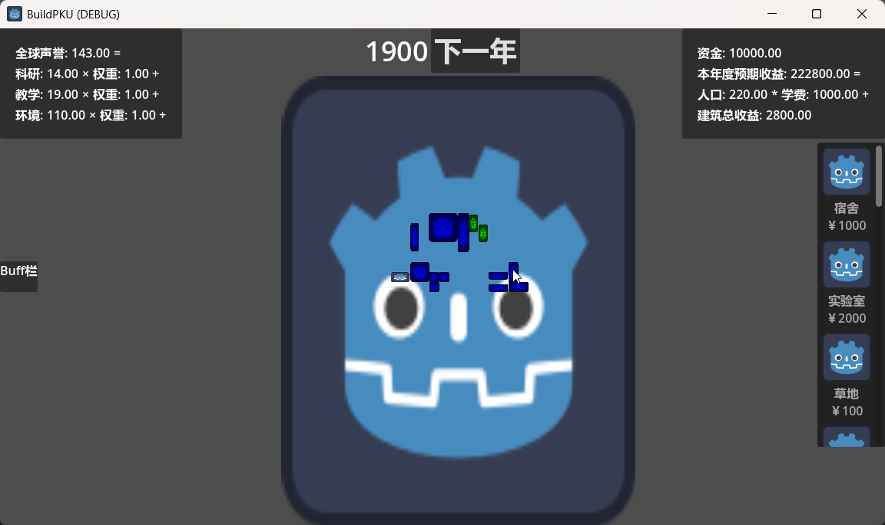
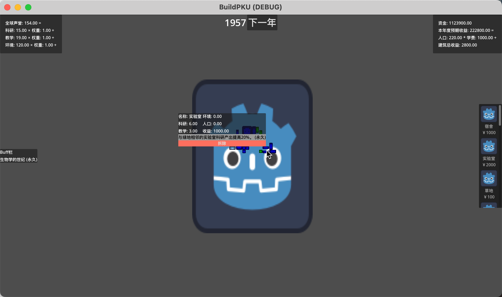

# 5.4

搭建 GridMgr, BuildingMgr基础框架

当前场景结构:

### TODO: 把建筑种类, 以及各种config数据分离出来

# 5.5

优化代码架构, 实现相机移动, 建筑旋转, Ysort遮挡关系

# 5.6

加了一个时间管理器，可以控制年份前进。加了一个hud ui显示。加了一个摄像机的移动限制。

# 5.7

加了右侧选择建筑的，现在支持快捷键选择点击选择，右键和escape以及重复点击快捷键或右侧栏来取消。

# 5.11

金钱系统，包括初始金钱，每年自然增长，放建筑花钱和钱不够的提示。另外把读取buildingjson重新提了一个工具类文件出来。

实现ScoreMgr, 计分板, 优化单例类实现方式

实现初始建筑功能, 将建筑添加到buildingMgr子节点, 命名为ID加任意数字, 例如:Dorm35, Lab1

# 5.12

新增卡片选择功能，目前只实现了ui类和相应的管理类，没有实现卡片的逻辑，把jsondata统一挪到一个文件夹下面了。

实现了修改评分权重的buff类，同样通过json来管理，card和buff的名字对应上即可。

zyj: 增加相邻加成, 实现正确收益计算, 取消人口对科研教学的加成, 默认分辨率设置为1080p, ui随屏幕缩放

# 5.14

zyj: 鼠标悬停显示建筑信息, 实现拆除功能

# 5.15

zyj: 鼠标悬停显示正在影响当前建筑的buff, 实现升级, 不可拆除, 建筑最大建造数量

# 5.16

修改卡片和buff栏，现在的逻辑是所有获得的卡片都会在卡片栏显示，卡片栏可以收起。同时单独给一个相邻加成栏展示目前可用的相邻加成效果。

做了立刻加金钱的buff。type是InstantMoney

# 5.17

做了解锁建筑和维护用户可见建筑列表。
zyj: 实现多升级分支

# 5.18

小而美
