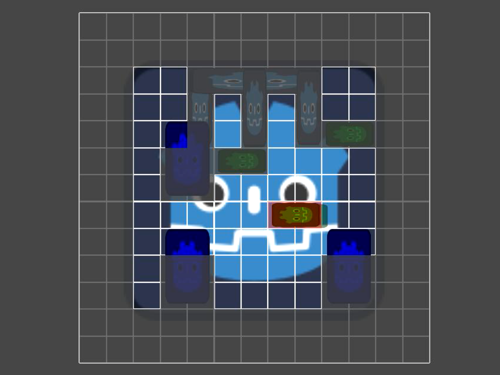
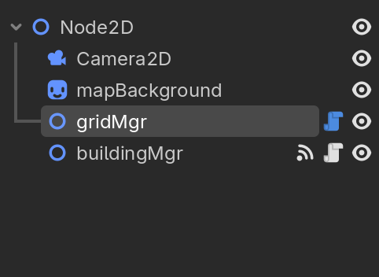
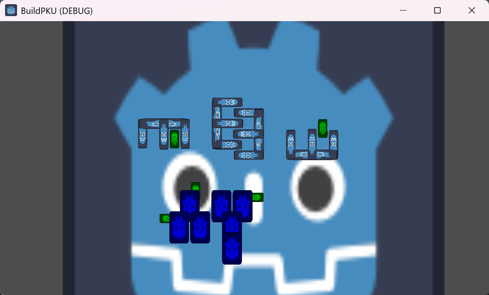
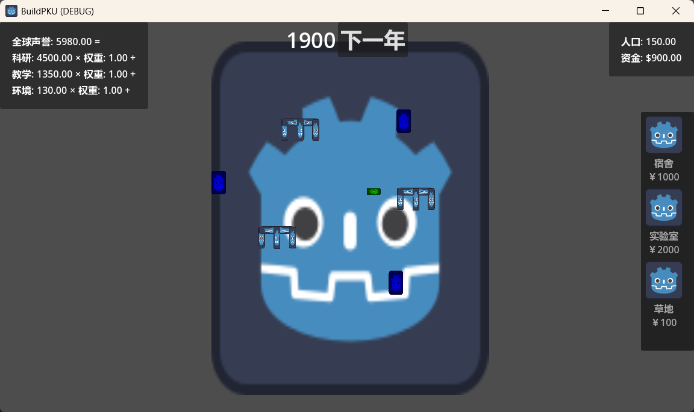

# 5.4

搭建 GridMgr, BuildingMgr基础框架

当前场景结构:

### TODO: 把建筑种类, 以及各种config数据分离出来

# 5.5

优化代码架构, 实现相机移动, 建筑旋转, Ysort遮挡关系

# 5.6

加了一个时间管理器，可以控制年份前进。加了一个hud ui显示。加了一个摄像机的移动限制。

# 5.7

加了右侧选择建筑的，现在支持快捷键选择点击选择，右键和escape以及重复点击快捷键或右侧栏来取消。

# 5.11

金钱系统，包括初始金钱，每年自然增长，放建筑花钱和钱不够的提示。另外把读取buildingjson重新提了一个工具类文件出来。

实现ScoreMgr, 计分板, 优化单例类实现方式

实现初始建筑功能, 将建筑添加到buildingMgr子节点, 命名为ID加任意数字, 例如:Dorm35, Lab1